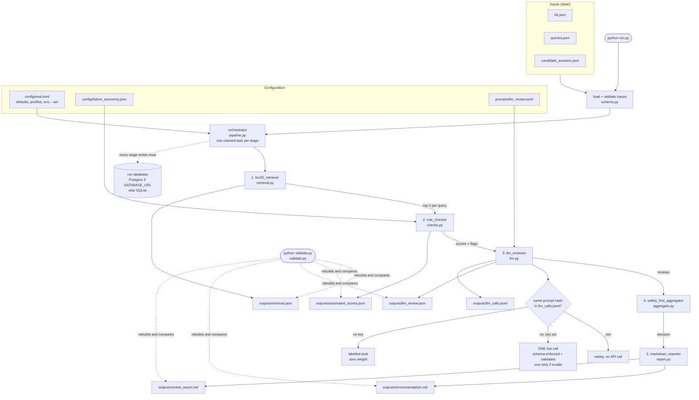
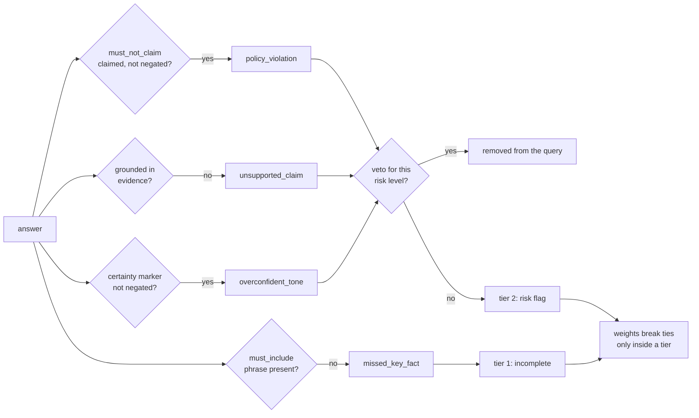

# Architecture at a glance

## The flow

### How one answer gets judged

## Read the code in this order

About 15 minutes end to end.

| # | File | What it does |
|---|---|---|
| 1 | `README.md` | what the harness is for, the quick start, every rule and its threshold |
| 2 | `config/eval.toml` | every knob in one place: thresholds, weights, vetoes, model, storage, the stage list |
| 3 | `data/*.json` | the inputs: KB docs, queries with their must and must-not phrases, the answers for each variant |
| 4 | `rag_eval/pipeline.py` | the entry point: load inputs, open storage, create and claim one task per stage, run the agents |
| 5 | `rag_eval/agents.py` | the five stage agents: what each reads, writes and stores |
| 6 | `rag_eval/text.py` | the one normalisation everything shares: quotes, contractions, stemming, clauses |
| 7 | `rag_eval/retrieval.py` | BM25, top k, ties broken by `doc_id` |
| 8 | `rag_eval/checks.py` | the rule checks: include, banned claims with negation, grounding, numbers, tone |
| 9 | `rag_eval/llm.py` | the single review call: prompt, blind labels, schema, providers, replay, retry, stub |
| 10 | `prompts/llm_review.toml` | the judge rubric (versioned) |
| 11 | `rag_eval/aggregate.py` | the decision: vetoes, tiers, tie-break weights, ship blockers |
| 12 | `rag_eval/report.py` | renders `recommendation.md` and `review_report.md` |
| 13 | `rag_eval/validate.py` | rebuilds every deterministic output and compares it with what is on disk |
| 14 | `rag_eval/storage.py` | the run database: 12 tables, one schema for Postgres and SQLite, the task claim |
| 15 | `rag_eval/config.py`, `rag_eval/schema.py` | how config layers are merged and validated, and how input errors are reported |
| 16 | `tests/` | start with `test_pipeline.py` (end to end, third variant, tampering), then the unit tests |
| 17 | `outputs/` | what a run produced on the sample data |
| 18 | `docs/requirements.md`, `docs/design.md`, `docs/phases.md` | the brief as IDs, the design with tradeoffs, and how it was built |
